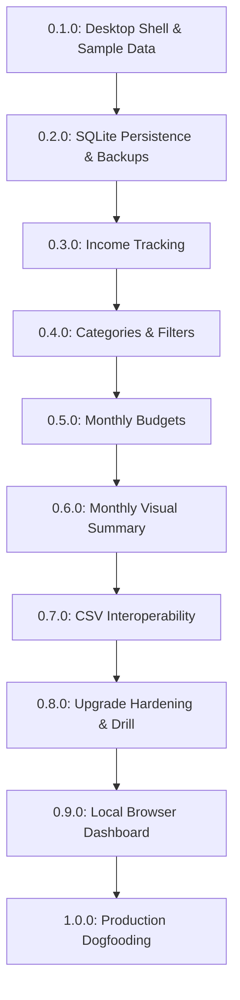

# Nest

> **Local-first personal finance desktop application: track spending and income, enforce monthly budgets, and analyze financial health without surrendering your data to the cloud.**

[](#milestone-roadmap)
[-brightgreen)](#system-architecture)
[](#010--desktop-shell--sample-expense-workspace)

---

## 1. System Vision & Principles

Nest is designed around three non-negotiable principles:
1. **Local-First & Private by Default**: Your financial life belongs on your own machine. Nest stores records in a local SQLite database, operates completely offline, and requires no external database servers, background daemon processes, or paid cloud subscriptions.
2. **Deterministic Arithmetic**: Floating-point math has no place in financial software. Nest stores all monetary values as whole integer **paise** with strict bounds checking.
3. **Dual Surface Experience**: An installed desktop workspace (Tauri 2) for day-to-day record entry and management, coupled with an optional, opt-in **read-only local browser dashboard** for reviewing monthly summaries on your laptop browser.

---

## 2. System Architecture

```text
+-------------------------------------------------------------------------------+
|                                  USER DEVICE                                  |
|                                                                               |
|  +-----------------------------+             +-----------------------------+  |
|  |   Tauri Desktop Workspace   |             |    Read-Only Browser View   |  |
|  |   (React, TypeScript, Vite) |             |  (Shared React Components)  |  |
|  +--------------+--------------+             +--------------+--------------+  |
|                 | Tauri IPC                                 | HTTP GET        |
|                 v                                           v (127.0.0.1)     |
|  +----------------------------------------------------------+--------------+  |
|  |                        RUST APPLICATION CORE                            |  |
|  |                                                                         |  |
|  |   - Input Validation (Domain Rules)       - Optional Loopback Server    |  |
|  |   - Prepared SQL Queries & Migrations     - Atomic Backup / VACUUM      |  |
|  +----------------------------------------------------------+--------------+  |
|                                                             | rusqlite        |
|                                                             v                 |
|                                              +-----------------------------+  |
|                                              |     Local SQLite Database   |  |
|                                              |     (OS AppData Directory)  |  |
|                                              +-----------------------------+  |
+-------------------------------------------------------------------------------+
```

### Technology Baseline

| Layer | Technology | Engineering Rationale |
|---|---|---|
| **User Interface** | React, TypeScript, HTML/CSS (Vite) | Declarative UI components, strong type safety, zero build overhead. |
| **Desktop Shell** | Tauri 2 | Native performance, tiny bundle footprint, robust OS integration. |
| **Native Core** | Rust service functions | Owns SQL queries, input validation, atomic writes, and file I/O outside the frontend webview. |
| **Persistence** | Embedded SQLite (`rusqlite`) | Zero-configuration single-file database running in-process. |
| **Browser Companion** | Opt-in local HTTP listener | Restricted to `127.0.0.1`; exposes read-only summary endpoints while desktop app is running. |
| **Verification** | Vitest, Rust `cargo test`, GitHub Actions | Strict CI covering TypeScript checks, unit tests, and native Windows builds. |

---

## 3. Core Domain & Security Invariants

### Monetary Arithmetic & Dates
- **Integer Paise Representation**: All monetary figures are stored and calculated as integers representing **paise** (`₹10.50` is stored as `1050`). Decimal parsing converts directly to integers; floating-point multiplication is prohibited.
- **Positive Transaction Amounts**: Transaction values must always be strictly positive integers (`> 0`). Directionality is captured via a explicit `kind` enum (`expense` vs. `income`).
- **Domain Limit**: Absolute limit of **1,000,000,000,000 paise** (₹10,000,000,000). Calculations check for overflow before persistence.
- **Strict Calendar Dates**: Stored as ISO `YYYY-MM-DD`. Validated against the Gregorian calendar (including leap years). Never distorted through local/UTC timezone translations. Audit creation time is preserved in a separate UTC timestamp (`createdAt`).

### Persistence & Data Recovery
- **OS App-Data Directory**: Databases and configuration reside in the OS-resolved local application data folder (`%LOCALAPPDATA%\nest` on Windows). Never written to the repository or application installation directory.
- **Single Instance Lock**: Exclusive process locking on the database directory prevents concurrent writes and corruption during migrations or restores.
- **Ordered Migrations**: Schema changes are managed via numbered, immutable SQL migration files wrapped in atomic database transactions.
- **Verified Backups**: Backups are generated via SQLite's Online Backup API or `VACUUM INTO` to ensure point-in-time consistency without locking out reading. A full recovery drill (restoring into a clean database and comparing checksums/totals) is required prior to entering production data.

### Browser Dashboard Security
- **Opt-In Loopback Only**: The companion HTTP server is disabled by default. When toggled from the desktop app, it binds exclusively to `127.0.0.1` (and `::1`). Never binds to `0.0.0.0` or LAN interfaces.
- **Host & Origin Validation**: Every HTTP request verifies strict `Host` and `Origin` headers against the assigned local port. Unexpected cross-origin requests are rejected.
- **Read-Only Scope**: The HTTP server exposes only pre-aggregated monthly summary queries. No database mutations, file downloads, or native shell commands are exposed to the browser.
- **No-Store Caching**: All summary responses carry `Cache-Control: no-store` to prevent caching of sensitive financial data in browser or proxy caches.

---

## 4. Milestone Roadmap

Only one milestone is actively implemented at a time. The active development target is **v0.1.0**.



### Phase 1: Core Personal Finance (v0.1.0 – v1.0.0)

#### `0.1.0` · Desktop Shell & Sample Expense Workspace
- **Goal**: Establish the Tauri 2 + React + TypeScript development and build pipeline; verify standalone Windows installer delivery.
- **Scope**: Labeled expense entry form (amount, date, note), expense list, delete action, and live total calculation. In-memory storage only (data resets on app restart).
- **Exit Gate**: Standalone Windows installer (`setup.exe`) installs and runs on a clean machine without developer tools. Keyboard accessibility verified. Explicit sample-data warning displayed.

#### `0.2.0` · SQLite Persistence & Recoverable Data
- **Goal**: Provide durable local persistence and proven backup/restore capabilities.
- **Scope**: Rust commands for CRUD operations using `rusqlite`; numbered SQL migration v1; atomic snapshot backups and safe restore mechanism.
- **Exit Gate**: Expenses survive application restarts and system reboots. Duplicate submissions rejected. Off-device backup restores completely into a clean database with identical record counts and financial totals.

#### `0.3.0` · Income Tracking & Net Cash Flow
- **Goal**: Support incoming funds without altering historical expense semantics.
- **Scope**: Explicit transaction type (`expense` | `income`); separate aggregated totals for Inflow, Outflow, and Net Difference.
- **Exit Gate**: Existing records safely migrated. Restored backups reconcile both income and expense categories accurately.

#### `0.4.0` · Categories & Transaction Filtering
- **Goal**: Categorize transactions and provide month-scoped activity views.
- **Scope**: Category management with default seed values (Food, Rent, Bills, Transport, Salary, Other); category archival (preserves historical links); month and category filters.
- **Exit Gate**: All transactions linked via foreign keys to valid categories. Renaming/archiving preserves historical records. Filtered totals reconcile with aggregate queries.

#### `0.5.0` · Monthly Category Budgets
- **Goal**: Proactive financial planning per calendar month.
- **Scope**: Category budget limits; live spending vs. budget comparison; explicit text warnings for near-limit and overspent categories.
- **Exit Gate**: Database uniqueness constraint prevents duplicate budgets per category/month. Spending calculations match transaction sums exactly.

#### `0.6.0` · Monthly Summary & Breakdown
- **Goal**: High-level visual snapshot of monthly financial performance.
- **Scope**: Monthly overview card (income, expenses, savings rate); accessible category breakdown chart with complementary data table.
- **Exit Gate**: Totals reconcile across all views. Chart component functions cleanly without external network access.

#### `0.7.0` · CSV Data Interoperability
- **Goal**: Allow data portability and independent auditing.
- **Scope**: Export transactions to standardized CSV format with RFC 4180 escaping, UTF-8 encoding, and formula injection protection.
- **Exit Gate**: Exported files open accurately in Excel and spreadsheet tools with matching totals.

#### `0.8.0` · Installer Upgrades & Multi-Machine Recovery
- **Goal**: Harden delivery and verify real-world upgrade safety.
- **Scope**: Verify in-place installer upgrade over older versions; clean-machine backup restore drill; fail-safe recovery error handling.
- **Exit Gate**: Application upgrade preserves existing user database. Corrupt backup detection leaves existing active data unharmed.

#### `0.9.0` · Local Browser Dashboard
- **Goal**: Convenient, read-only monthly overview in a standard browser.
- **Scope**: Opt-in Rust HTTP service on `127.0.0.1`; shared React summary views; session token validation; `Cache-Control: no-store`.
- **Exit Gate**: Desktop app operates normally with dashboard disabled. When enabled, browser displays matching summary metrics. Zero mutation routes exposed.

#### `1.0.0` · Production Readiness & Daily Use
- **Goal**: Prove stability through continuous daily personal dogfooding.
- **Scope**: Minimum 14 consecutive days of daily personal tracking; resolution of all discovered edge cases.
- **Exit Gate**: Zero data loss, exact reconciliation, complete documentation, tagged `v1.0.0`.

---

### Phase 2: Post-V1 Extensions (v1.1.0 – v1.4.0)
- **1.1.0 — Accounts & Opening Balances**: Support for distinct bank, cash, and credit card accounts.
- **1.2.0 — Transfers & Split Transactions**: Double-entry account transfers and multi-category expense splitting.
- **1.3.0 — Bank Statement CSV Import**: Controlled statement ingestion with preview, column mapping, and duplicate detection.
- **1.4.0 — Account Reconciliation Pilot**: Full statement reconciliation drill against real bank statements.

---

## 5. Development & Contribution Workflow

### Branching & Release Hygiene
- **Branch Strategy**: Development occurs on short-lived branches created from `main`:
  - `feature/<name>` for new capabilities
  - `fix/<name>` for bug fixes
- **Understanding Check**: Before pushing code to remote, the user must complete the Socratic quiz detailed in [`skills/understanding-check/SKILL.md`](skills/understanding-check/SKILL.md). The pre-push hook (`.githooks/pre-push`) enforces this gate.
- **Semantic Versioning**: Releases are tagged directly on `main` following standard SemVer: `v0.1.0`, `v0.2.0`, `v1.0.0`.

### Initial Setup
```powershell
# 1. Enable understanding-check pre-push hook
git config core.hooksPath .githooks

# 2. Verify prerequisites
node --version
cargo --version
```
