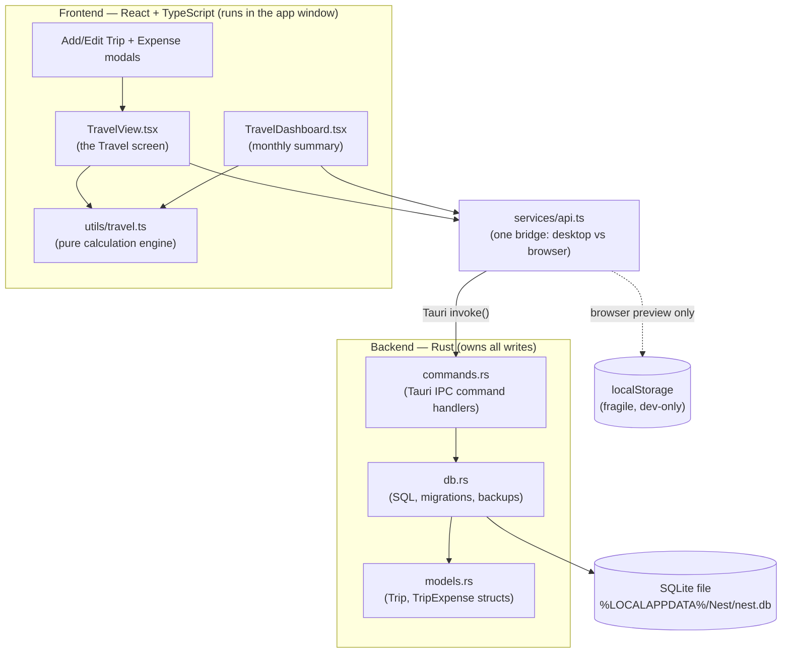
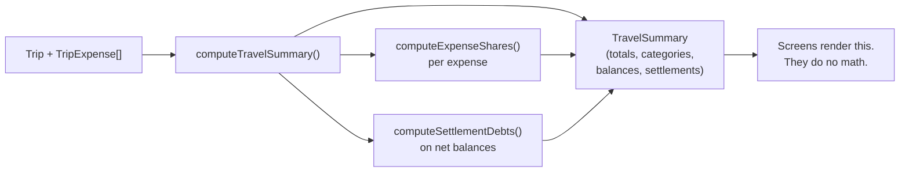
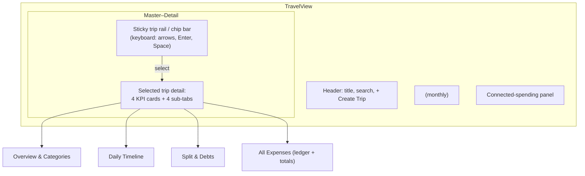
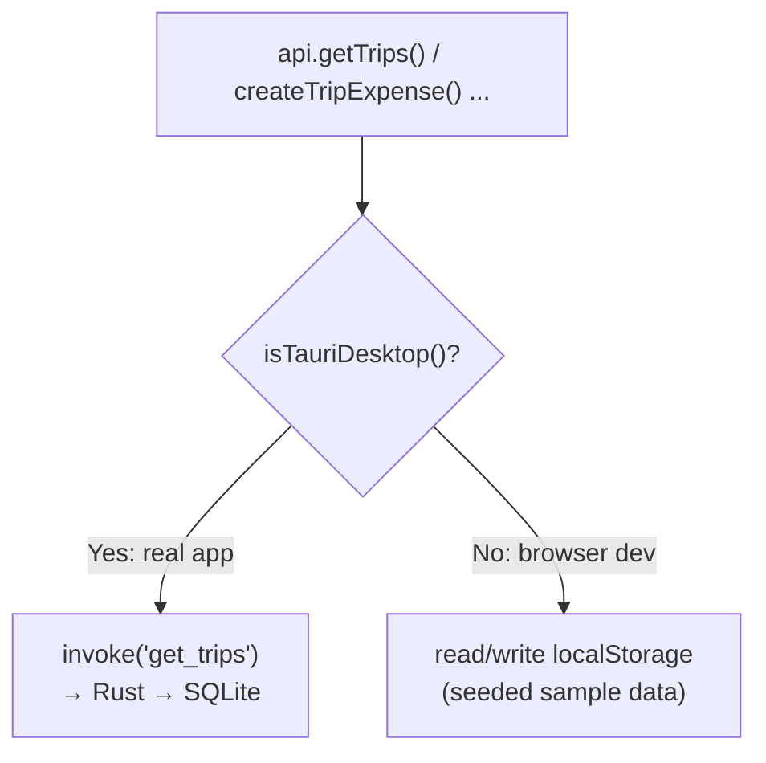
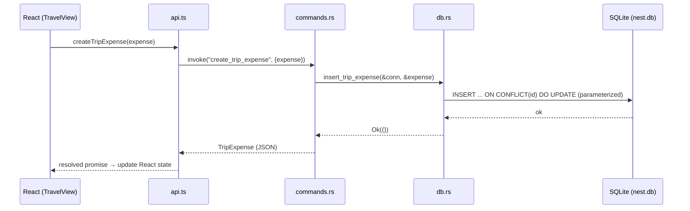
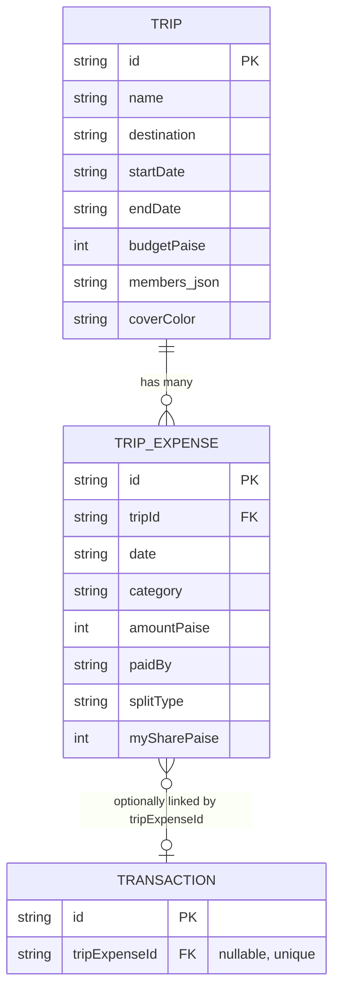
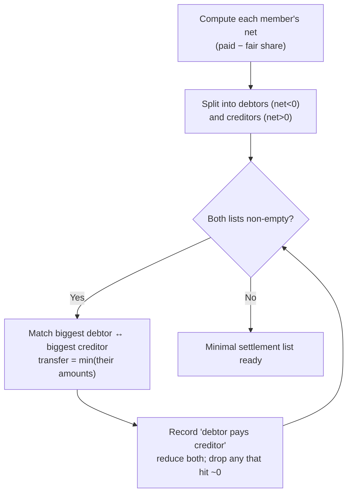
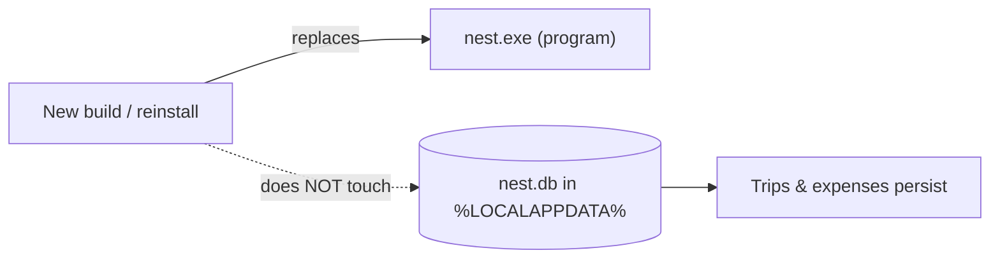

# Nest — Travel Module: Design & Implementation Document

> **Scope**: The Travel (trip expenses) module of Nest, as built on branch `feature/travel-expenses`.
> **Audience**: Written to be understood by a beginner, while remaining a complete, professional
> reference. New concepts are named and explained the first time they appear.
> **Status**: Describes the implemented feature. Out-of-scope ideas are noted and kept in
> [`IDEAS.md`](IDEAS.md), not built here.

---

## 1. What this module does (plain language)

The Travel module answers a simple real-life question: **"We went on a trip, several people spent money,
who owes whom, and how much did I actually spend?"**

You create a **Trip** (name, destination, dates, a budget, and the list of people on it). Under that trip
you log **Expenses** (a dinner, a taxi, a hotel night). Each expense records the full amount, who paid,
and how it is split. From that raw data the module calculates everything else: your personal share, the
daily spending pace, a category breakdown, each person's net balance, and the smallest set of payments
that settles the group up. It also feeds your monthly dashboards so travel spending shows up in your
normal finance view **without being double-counted**.

Everything runs **100% offline on your own machine**. Money is never a floating-point number — it is
stored as whole **paise** (₹12.50 is stored as the integer `1250`). This is a deliberate correctness
rule, explained in Section 6.

---

## 2. Where the Travel module sits in the whole app

Nest is a **Tauri 2** desktop app: a native window whose user interface is built with **React +
TypeScript**, and whose "backend" is a small amount of **Rust** that owns the **SQLite** database file.
"Tauri" is the framework that lets a web UI run as a real installed Windows program and talk to Rust.

**The golden rule of the architecture:** the React UI never touches the database or files directly. It
only asks named operations like "get trips" or "create expense" through one bridge (`api.ts`). In the
real desktop app those requests go to Rust, which is the **single owner of every write to disk**. This is
the *Separation of Concerns* principle (Section 6): the screen decides *what to show*, Rust decides *how
data is safely stored*.

---

## 3. Module-by-module architecture

Each sub-part has one clear job. Below, each gets a short "what it is", a "why it exists", and a diagram.

### 3.1 The calculation engine — `src/utils/travel.ts`

**What it is:** a file of **pure functions**. A *pure function* takes inputs and returns an output with no
side effects — it never saves data, never calls the network, never changes anything outside itself. Given
the same trip and expenses, it always returns the same summary. That makes it trivial to test.

**Why it exists:** all the money math lives in one place, isolated from the UI. The screens stay "dumb"
(they display results); the engine stays "smart" (it computes them). This is the *Single Responsibility
Principle*.

**Key functions:**

| Function | Input | Output | Job |
|---|---|---|---|
| `computeExpenseShares` | amount, members | each person's share (integer paise) | Split money with **zero lost paise** |
| `computeTravelSummary` | one trip + its expenses | a `TravelSummary` object | Totals, daily average, categories, balances |
| `computeSettlementDebts` | member balances | list of "A pays B" transfers | Minimize number of settlements |
| `computeTravelDashboard` | all trips + expenses + month | monthly dashboard data | Feed the finance dashboard |
| `calculateTripDays` | start/end date | inclusive day count | Leap-year-safe date math |

### 3.2 The Travel screen — `src/views/TravelView.tsx`

**What it is:** the main Travel page. It uses a **master–detail layout**: a compact, sticky list of trips
on the left (the "master"), and the selected trip's full detail on the right (the "detail"). On a narrow
window the left list collapses into a horizontal bar of minimal chips. Only one trip's detail shows at a
time, so you never scroll through a giant stack of open trips.

**Why this design:** an earlier version stacked every trip as a big expandable card; opening several meant
endless scrolling. Master–detail fixes that by separating *selection* from *display*.

**State it owns (React `useState`):** which trip is selected, the last trip you explicitly clicked
(so a cleared search can restore your intent), which sub-tab is open, and the search/filter text. Notice
it owns **UI state only** — never the authoritative data. The data comes from the app via props.

### 3.3 The monthly dashboard — `src/components/TravelDashboard.tsx`

**What it is:** a read-only summary for the **selected month**: your travel spending, group bills, amounts
you paid, trips active that month, a category breakdown, per-trip budget check-ins, and the latest five
expenses (each linking back to its source row).

**Why it is separate from `TravelView`:** the dashboard is about *a month across all trips*; the trip
detail is about *one trip across all its dates*. Different questions, different components.

### 3.4 The input dialogs — `AddTripModal.tsx`, `AddTravelExpenseModal.tsx`

**What they are:** controlled forms. The expense modal supports both **add** and **edit** (prefill every
field, recompute the share, save under the same ID). It shows a **live split preview** so you see your
share before saving. Validation (non-empty title, strict `YYYY-MM-DD` date, valid positive amount) happens
here for instant feedback — and is independently re-checked by Rust before any write (defense in depth).

### 3.5 The bridge — `src/services/api.ts`

**What it is:** the one place that knows whether we are in the real desktop app or a browser preview.

**Why it exists:** the screens call `api.getTrips()` and genuinely do not care where the data lives. Swap
the storage and the UI is unaffected. This is *Dependency Inversion*: the UI depends on an abstraction
(the `api` interface), not on a concrete database.

### 3.6 The native core — `commands.rs`, `db.rs`, `models.rs`

- **`models.rs`** — Rust structs (`Trip`, `TripExpense`) with `#[serde(rename_all = "camelCase")]` so Rust's
  `snake_case` fields become the `camelCase` JSON the TypeScript expects. One schema, two languages, no
  manual mapping.
- **`commands.rs`** — thin `#[tauri::command]` functions. Each locks the DB connection and delegates to a
  `db.rs` function. They are deliberately tiny: transport in, result out.
- **`db.rs`** — the real work: table creation, **numbered migrations** (`PRAGMA user_version`),
  **parameterized SQL** (safe against injection), atomic transactions, and `VACUUM INTO` backups.

---

## 4. Data model (the exact contracts, from the real code)

Two languages describe the same shapes. Keeping them in lock-step is enforced by `serde` on the Rust side.

### 4.1 `Trip`

| Field | Type | Meaning |
|---|---|---|
| `id` | string | Stable unique ID (e.g. `trip-...`) |
| `name`, `destination` | string | Display text |
| `startDate`, `endDate` | string `YYYY-MM-DD` | Trip window (inclusive) |
| `budgetPaise` | integer | Whole-paise budget; `0` means "no budget set" |
| `members` | string[] | Companions, e.g. `["Me", "Aarav", "Pooja"]` |
| `coverColor` | string | Accent color for the trip's UI |
| `createdAt` | string | Creation timestamp |

### 4.2 `TripExpense`

| Field | Type | Meaning |
|---|---|---|
| `id` | string | Stable unique ID |
| `tripId` | string | Foreign key → the owning `Trip` |
| `date` | string `YYYY-MM-DD` | When it happened (drives monthly reports) |
| `title`, `notes?` | string | What it was |
| `category` | `TravelCategory` | One of: activities, stay, food, transport, fuel, shopping, other |
| `amountPaise` | integer | **Full** expense amount in whole paise |
| `paidBy` | string | Which member fronted the money |
| `splitType` | `equal` / `personal` / `custom` | How it is divided |
| `splitMembers` | string[] | Who shares this cost |
| `mySharePaise` | integer | **Your** portion, pre-computed in whole paise |

**Design note — why store `mySharePaise`?** It is derived from the amount and the split, so in theory it
could be recomputed every time. It is stored anyway so that (a) your personal spending is a fixed
historical fact even if split rules ever change, and (b) the monthly dashboard can sum it cheaply without
re-running the split for every expense.

---

## 5. The two algorithms that matter

### 5.1 Splitting money with zero lost paise

Dividing ₹100.00 (10000 paise) among 3 people is `3333.33...` each — impossible in whole paise. Naive
rounding loses a paisa and the parts no longer sum to the whole. The engine fixes this deterministically:

1. `base = floor(amount / count)` — everyone gets the base share.
2. `remainder = amount % count` — the leftover paise.
3. Hand **one extra paisa** to the first `remainder` members.

So 10000 ÷ 3 → `3334, 3333, 3333`, which sums back to exactly `10000`. **No paisa is ever created or
destroyed.** This is the whole-paise correctness rule applied to division.

### 5.2 Settling the group with the fewest transfers

For each member: `net = (what they paid) − (their fair share)`. Positive net = they are owed money;
negative = they owe. The settlement uses a **greedy debt-minimization** algorithm: repeatedly match the
largest debtor against the largest creditor and transfer the smaller of the two amounts. This produces a
minimal, easy-to-act-on list like "Aarav pays Me ₹1,200" instead of everyone paying everyone.

---

## 6. Software design principles used here (named, with where they live)

These are the professional principles the module follows. Each is explained plainly.

- **Separation of Concerns** — different jobs live in different places. UI (`TravelView`) shows things;
  the engine (`utils/travel.ts`) computes; Rust (`db.rs`) persists. Changing one rarely disturbs another.
- **Single Responsibility Principle (SRP)** — each function/module does *one* thing. `computeExpenseShares`
  only splits; `computeSettlementDebts` only settles.
- **Dependency Inversion / abstraction** — screens depend on the `api` interface, not on SQLite or
  localStorage. The storage can change beneath them (`api.ts` hides the difference).
- **Pure functions & determinism** — the calculation engine has no side effects, so the same inputs always
  give the same output. This is why the test suite can assert exact paise.
- **Defense in depth (validate twice)** — the form validates for fast feedback; Rust re-validates the same
  domain rules (positive paise, valid dates) before writing. The UI is never trusted as the last word.
- **Fail safe, never lose data** — migrations are additive and idempotent; a failed write leaves existing
  data intact; backups use SQLite's consistent `VACUUM INTO`.
- **Idempotency** — creating an expense uses `INSERT ... ON CONFLICT(id) DO UPDATE`, so a retried save with
  the same ID updates rather than duplicating. This is also how **editing** an expense works.
- **No double-counting (a domain invariant)** — linking a trip expense to a ledger payment is a *reference
  only*. It never creates a second expense, and personal category totals count your share exactly once.
- **Money is integer paise, always** — no floating point anywhere in money math; checked addition guards
  against overflow (`addPaise`). Rupees-with-a-decimal exists only at the display edge.

---

## 7. How your data survives rebuilds (persistence model)

This is the question "will my trips be erased by a new build?" — answered precisely.

- **Desktop app:** trips live in `%LOCALAPPDATA%\Nest\nest.db`, a SQLite file **outside the repo and
  outside the install folder**. Rebuilding or reinstalling replaces the *program*, not the *data file*, so
  **your trips survive builds, restarts, and upgrades**. `tauri dev` and a production build share the same
  file.
- **Browser preview (`npm run dev`):** there is no database; data falls back to `localStorage`, which is
  **fragile and dev-only**. Do not keep real data here.
- **Schema changes stay safe** because migrations are gated on `PRAGMA user_version` and are *additive*
  (`CREATE TABLE IF NOT EXISTS`, guarded `ALTER TABLE ADD COLUMN`) — running them again is a no-op.

**Rules for any future Travel enhancement that changes the schema:** never move `get_db_path()`; only add,
never destructively recreate a table that holds data; keep each migration idempotent and version-gated;
take a `VACUUM INTO` backup before applying a new migration. (A full real-world backup→restore drill is
recommended before relying on real trip data — it is listed as outstanding in the V1 tracker.)

---

## 8. Scope boundary (what this module deliberately does NOT do)

Per the project's version discipline, the Travel module stays within V1 and parks the following in
[`IDEAS.md`](IDEAS.md): no "mark as settled"/settlement-tracking subsystem, no side-by-side trip
comparison, no OCR/receipt scanning or barcode input, no automation or background reminders, no new
account cash-flow writes from travel. Travel totals *overlap* the connected category dashboards as
different views of the same expenses — they are never an extra spending category or a bank cash-flow entry.

---

## 9. File map (where to look in the code)

| File | Responsibility |
|---|---|
| `src/utils/travel.ts` | Pure calculation engine: splits, summary, settlement, dates, category metadata |
| `src/views/TravelView.tsx` | Master–detail screen, sticky rail/chips, sub-tabs, ledger, keyboard nav |
| `src/components/TravelDashboard.tsx` | Selected-month summary and per-trip budget check-ins |
| `src/components/AddTripModal.tsx` | Create/edit a trip |
| `src/components/AddTravelExpenseModal.tsx` | Create/edit an expense, live split preview |
| `src/styles/workspaces.css` | Scoped Travel styles (rail, chips, tables, dark/light theme) |
| `src/services/api.ts` | Desktop-vs-browser storage bridge |
| `src/types/index.ts` | TypeScript contracts (`Trip`, `TripExpense`, `TravelSummary`, ...) |
| `src-tauri/src/models.rs` | Rust structs mirroring the TS contracts (camelCase via serde) |
| `src-tauri/src/commands.rs` | Tauri IPC command handlers for trips/expenses |
| `src-tauri/src/db.rs` | SQL, numbered migrations, parameterized queries, backups |

---

*End of document. This describes the Travel module as implemented on `feature/travel-expenses`.*
